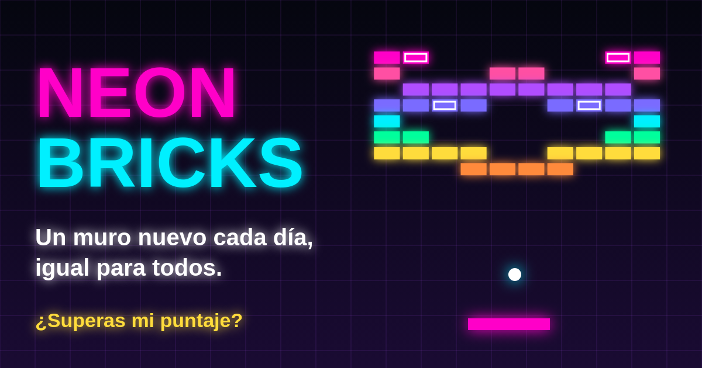

# Neon Bricks

**Un muro nuevo cada día, igual para todos.** Juego de romper ladrillos para el navegador, de código abierto, hecho con
JavaScript, CSS y HTML puros: sin frameworks, sin paso de compilación, sin registro.

- **Jugar:** [games.johnandrestrujillo.com/play/neon-bricks](https://games.johnandrestrujillo.com/play/neon-bricks)
- **Controles:** arrastra el dedo o mueve el ratón para mover la barra; toca, haz clic o pulsa Espacio para lanzar;
  Esc o P para pausar. También con las flechas.

*English: a brick breaker with one wall of the day, the same for everyone. Open-source browser game in plain
JavaScript. Add `?lang=en` for English.*



## Qué tiene

- **Muro del día.** La fecha decide la forma de cada muro, dónde van los ladrillos duros (dos golpes) y dónde se
  esconden los poderes. Todos juegan los mismos muros ese día. Detalles en [docs/DAILY.md](docs/DAILY.md).
- **Combos.** Cada tres ladrillos seguidos sin tocar la barra suben el multiplicador, hasta ×5.
- **Poderes:** barra ancha, tres bolas y cámara lenta.
- **Reta a alguien.** El resultado se comparte con un enlace que lleva el mismo muro y tu puntaje como meta.
- **Hecho para el teléfono.** Vertical, una mano, física a 120 pasos por segundo igual en cualquier equipo.
- **Español e inglés.**
- **Medición anónima.** Contadores sin cookies ni identificadores, que respetan "Do Not Track".

## Probarlo en tu máquina

```
python3 -m http.server 8000
```

y abre <http://localhost:8000>. Para jugar el muro de otro día: `?debug=true&day=2026-11-30`.

Prueba automática (Playwright): `tests/smoke.py`.

## Créditos y licencia

Código original de John Andrés Trujillo, publicado con [licencia MIT](LICENSE). El reto diario, la forma de compartir y
la medición vienen de su juego hermano, [Neon Raiders](https://github.com/jatezzz/neon-raiders). Los sonidos se
sintetizan en el navegador. Este proyecto no está afiliado ni respaldado por los dueños de ningún juego de arcade clásico
ni de sus marcas.
